# AI DATA UNIVERSE

> **DATA IS NOT STATIC. IT IS A UNIVERSE TO EXPLORE.**

Experiência de Business Intelligence em 3D, interativa e cinematográfica, construída sobre um único modelo de dados: indicadores executivos, um universo tridimensional explorável, motor temporal, detecção estatística de anomalias, um copiloto analítico e um painel de BI convencional — todos lendo os mesmos números.

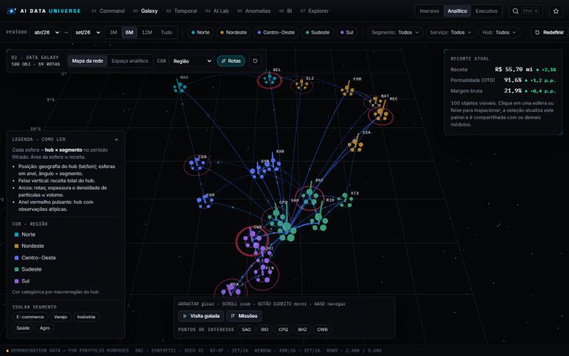

> **DEMONSTRATION DATA — FOR PORTFOLIO PURPOSES.**
> Todos os números vêm de um conjunto **sintético**, gerado de forma determinística no navegador (seed 42) para uma transportadora **fictícia** ("Helix Freight"). Apenas as coordenadas das cidades são reais. Nenhum dado, nome ou logotipo de empresa real é usado, e a aplicação **não** está conectada a nenhum sistema corporativo.

---

## Sumário

- [O que há aqui](#o-que-há-aqui)
- [O que é real, o que é sintético e o que não está conectado](#o-que-é-real-o-que-é-sintético-e-o-que-não-está-conectado)
- [Capturas de tela](#capturas-de-tela)
- [Executar localmente](#executar-localmente)
- [Variáveis de ambiente](#variáveis-de-ambiente)
- [Publicação](#publicação)
- [Arquitetura](#arquitetura)
- [Testes e medições](#testes-e-medições)
- [Acessibilidade e desempenho](#acessibilidade-e-desempenho)
- [Limitações conhecidas](#limitações-conhecidas)
- [Próximas versões](#próximas-versões)
- [Créditos](#créditos)

Documentação detalhada: [Arquitetura](docs/ARCHITECTURE.md) · [Mapeamento visual](docs/VISUAL_MAPPING.md) · [Métricas e métodos](docs/METRICS.md) · [Dicionário de dados](docs/DATA_DICTIONARY.md) · [Testes](docs/TESTING.md)

---

## O que há aqui

| # | Módulo | O que faz |
|---|---|---|
| — | **Abertura** | Sequência curta (≈3 s, pulável com botão ou `Esc`) com um log de inicialização que reflete trabalho real: geração do conjunto de dados, agregados, verificação de WebGL e download do motor 3D. Com `prefers-reduced-motion`, a animação é omitida. |
| 01 | **Command Center** | Índice de saúde operacional (núcleo 3D: cada órbita é um componente e o arco iluminado = pontuação), 9 KPIs com unidade, período, variação e referência, tendência de receita, resumo analítico determinístico, alertas, riscos e oportunidades. Cada KPI abre um painel com definição, fórmula, origem, qualidade, série e ranking. |
| 02 | **Data Galaxy** | Universo 3D (React Three Fiber) com 100 objetos hub × segmento. **Mapa da rede**: posição geográfica, feixes de receita e rotas com partículas proporcionais ao volume. **Espaço analítico**: X = pontualidade, Y = margem, Z = ticket, com linhas de média da rede formando quadrantes. Hover, seleção com painel contextual, isolamento por região/segmento, 5 modos de cor, visita guiada, pontos de interesse, missões analíticas validadas e navegação por teclado (WASD). |
| 03 | **Temporal Engine** | Terreno 3D hub × mês ligado a um *playhead* (reproduzir, pausar, passo a passo, velocidade, voltar ao início, fixar mês). Série com tendência linear, altas/quedas estatisticamente relevantes, tendência histórica × resultado atual e comparação entre dois períodos com alertas de validade. |
| 04 | **AI Analytics Lab** | Copiloto analítico. Respostas estruturadas em 8 partes (pergunta, resultado, evidência, período, critério, hipóteses, limitações, próxima investigação), fatos separados de hipóteses, histórico, sugestões, inspeção e exportação dos dados de suporte. |
| 05 | **Anomaly Detector** | 5 métodos (z-score histórico, IQR entre hubs, variação MoM, ano contra ano, quebra de tendência) com compatibilidade por tipo de métrica, limiar ajustável, ajuste por efeitos comuns da rede, prioridade, justificativa, próximos passos e destaque na Galaxy. |
| 06 | **Business Intelligence** | Série com comparação ano anterior, ranking, comparação de segmentos/serviços, participação, distribuição, mapa de calor região × mês, tabela com drill-down (região → hub → segmento → serviço), filtros cruzados por clique e exportações (CSV filtrado, tabela, relatório HTML). |
| 07 | **Data Explorer** | Tabela virtualizada e paginada da tabela fato, busca, ordenação, seleção de colunas, valores ausentes, duplicidades, verificações de integridade, resumo estatístico, metadados, dicionário de dados e fórmulas. |
| — | **Modos** | *Imersivo* (3D em primeiro plano), *Analítico* (acesso completo) e *Executivo* (briefing de leitura rápida). A troca preserva filtros, seleção e período. |
| — | **Transversal** | Filtros globais (período, região, segmento, serviço, hub), busca global `Ctrl K`, favoritos e histórico de exploração restauráveis (persistidos no navegador), estados de carregamento, vazio, erro e falha de IA. |

## O que é real, o que é sintético e o que não está conectado

| Item | Situação |
|---|---|
| Dados | **Sintéticos**, determinísticos (seed 42), 9.600 linhas: 24 meses × 20 hubs × 5 segmentos × 4 serviços. Contêm 6 cenários plantados e documentados para dar algo real a detectar. |
| Copiloto analítico | **Motor determinístico** implementado no próprio app: classificação de intenção por palavras-chave + análises calculadas. Cada resposta é rotulada "motor determinístico — sem LLM". |
| Modelo de linguagem | **Opcional e desligado por padrão.** Existe uma função serverless (`api/analyze.ts`) que chama a API da Anthropic (Claude) para redigir uma narrativa a partir dos fatos já calculados. Só é usada quando `VITE_AI_ENDPOINT` aponta para ela; a interface mostra "Modelo de linguagem · não conectado" quando não está. |
| Tempo real | **Não há.** O conjunto é um instantâneo estático; a barra de status mostra a data de referência. |
| Fonte real | A camada de dados aceita um CSV no mesmo formato (`VITE_DATA_URL`) sem alterar a interface. |

## Capturas de tela

| | |
|---|---|
| 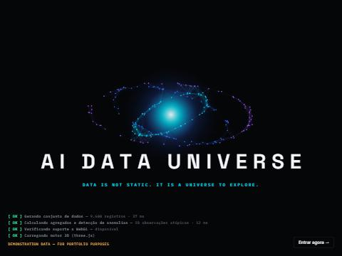 Abertura com log real de inicialização | 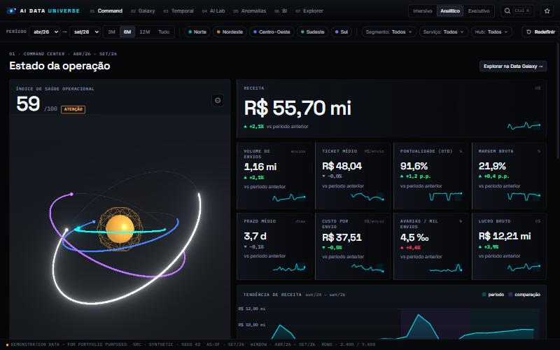 Command Center |
| 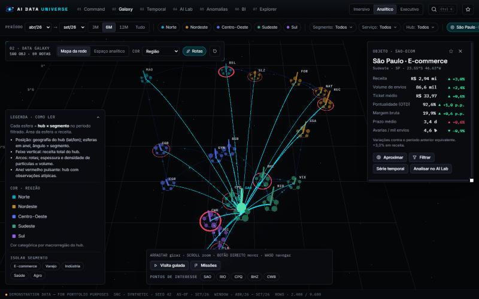 Seleção e painel contextual | 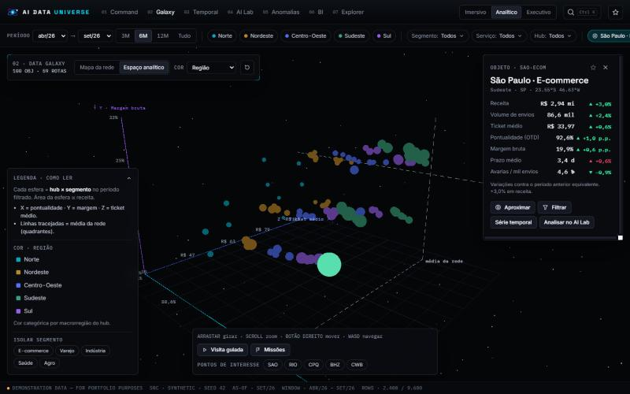 Espaço analítico 3D |
| 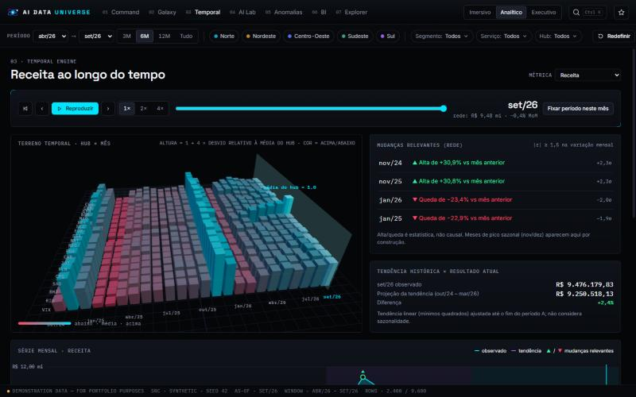 Temporal Engine | 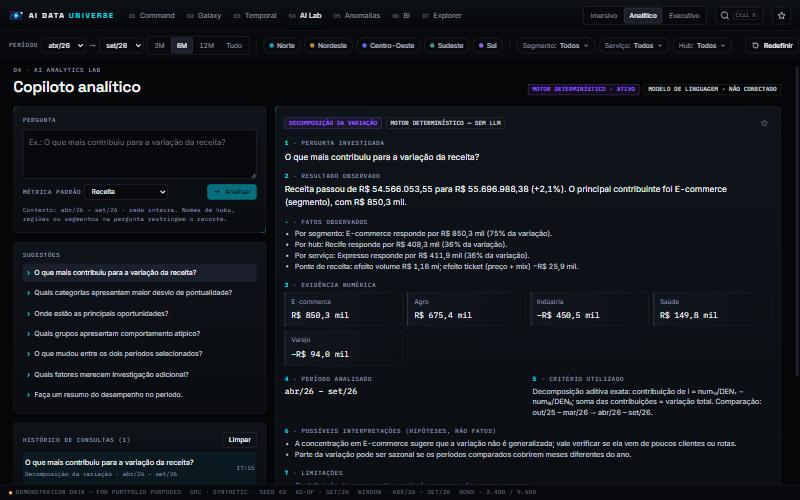 AI Analytics Lab |
| 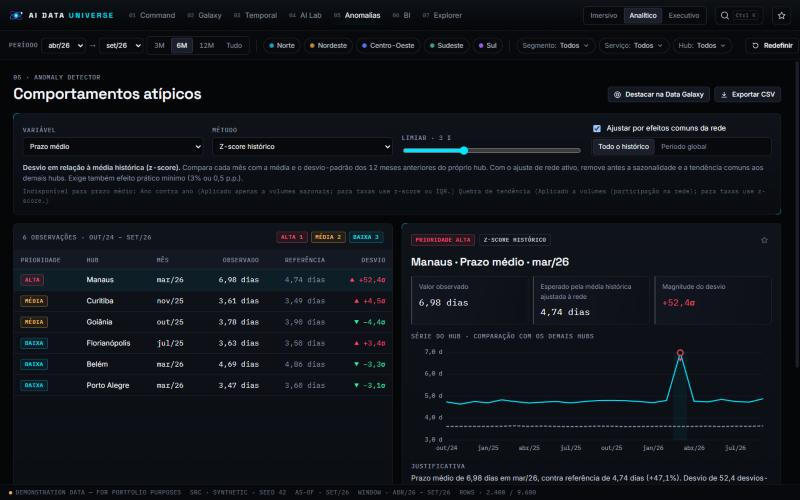 Anomaly Detector | 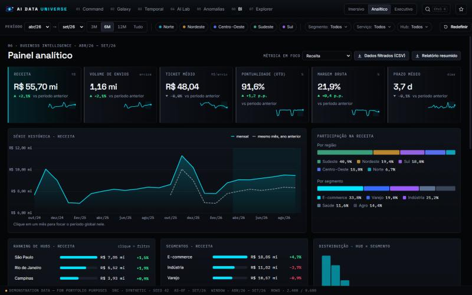 Business Intelligence |
| 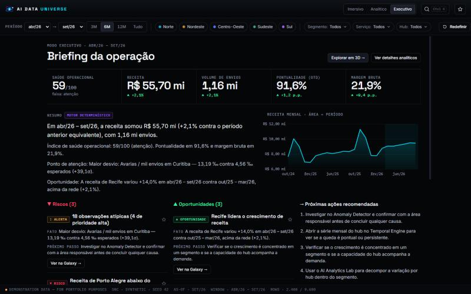 Modo executivo | 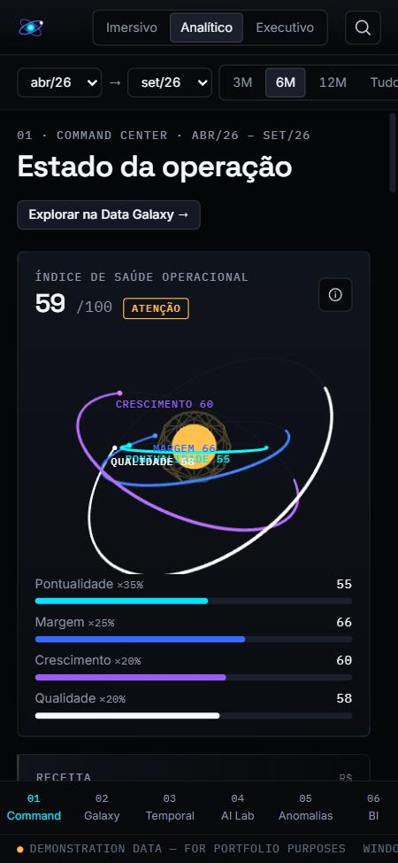 Celular (375 px) |

## Executar localmente

Requisitos: Node.js 20+ (testado com Node 24.15 e npm 11.12).

```bash
npm install
```

```bash
npm run dev
```

Abra `http://localhost:5173`. Outros scripts:

| Script | Função |
|---|---|
| `npm run build` | Typecheck (`tsc -b`) + build de produção em `dist/` |
| `npm run preview` | Serve o build de produção em `http://localhost:4173` |
| `npm test` | Testes unitários (Vitest) |
| `npm run lint` | ESLint (TypeScript + regras de hooks) |
| `npm run typecheck` | Verificação de tipos sem emitir arquivos |

Parâmetro útil: `?nowebgl` na URL força a visualização alternativa 2D (para testar o *fallback*).

## Variáveis de ambiente

Copie `.env.example` para `.env.local`. **Todas são opcionais** — sem nenhuma, o app roda 100% no navegador.

| Variável | Onde | Uso |
|---|---|---|
| `VITE_BASE` | build | Caminho base. `/` (Vercel) ou `/<repo>/` (GitHub Pages; o workflow define automaticamente). |
| `VITE_DATA_URL` | navegador | URL de um CSV no formato da tabela fato (ver [dicionário](docs/DATA_DICTIONARY.md)). Substitui o gerador sintético. |
| `VITE_AI_ENDPOINT` | navegador | URL da função `api/analyze` (ex.: `/api/analyze` na Vercel). Ativa a narrativa por LLM. |
| `ANTHROPIC_API_KEY` | **somente servidor** | Chave da API da Anthropic usada pela função. **Nunca** use o prefixo `VITE_` — ele exporia a chave no JavaScript público. |
| `ANTHROPIC_MODEL` | servidor | Modelo (padrão `claude-opus-5-5`). |
| `ALLOWED_ORIGIN` | servidor | Lista de origens permitidas (separadas por vírgula) quando o front-end e a função estão em domínios diferentes. |

O que a função recebe: apenas os fatos agregados já calculados (resultado, fatos, evidência, critério, limitações) — nunca linhas de dados. O tamanho do contexto é limitado a 24 KB e a pergunta a 500 caracteres. A requisição usa o *fallback* de recusa do servidor (`fallbacks: "default"`) e trata limites de taxa, credencial inválida e erros do provedor com mensagens explícitas; falhas aparecem na interface, e a análise determinística continua válida.

## Publicação

**GitHub Pages (somente front-end, recomendado para o portfólio).** O workflow [`.github/workflows/deploy.yml`](.github/workflows/deploy.yml) executa typecheck, lint, testes e build com `VITE_BASE=/<repo>/` a cada push na `main` e publica `dist/`. Em *Settings → Pages*, selecione **GitHub Actions** como fonte. O roteamento usa *hash* (`#/galaxy`), então não há necessidade de reescritas de rota.

**Vercel (front-end + IA opcional).** Importe o repositório; `vercel.json` já define o build e a função `api/analyze.ts`. Para ativar a narrativa por LLM, defina `ANTHROPIC_API_KEY` (servidor) e `VITE_AI_ENDPOINT=/api/analyze` (build) e faça um novo deploy.

Antes de publicar, confira: `npm run build` sem erros, `npm run preview` funcionando, nenhum arquivo `.env*` versionado (já estão no `.gitignore`) e nenhuma chave com prefixo `VITE_`.

## Arquitetura

```
src/
├─ data/        Camada de acesso: schema, gerador sintético (seed), DataSource (sintético | CSV), dicionário
├─ analytics/   Transformação: agregação aditiva, catálogo de métricas, saúde, anomalias, contribuição,
│               achados, missões, séries temporais, estatística — TypeScript puro, sem React
├─ ai/          Camada de IA: motor determinístico (intenções + análises) e cliente opcional de LLM
├─ state/       Estado global (zustand): filtros, modo, seleção, favoritos, histórico + hooks derivados
├─ three/       Visualização 3D: GalaxyScene, TerrainScene, CoreScene, câmera, projeção
├─ charts/      Visualização analítica 2D em SVG: linha, barras, participação, histograma, heatmap
├─ components/  Apresentação: shell, filtros, KPIs, busca, biblioteca, intro, estados
├─ modules/     Os 7 módulos + modo executivo (carregados sob demanda)
├─ lib/         Formatação pt-BR, CSV, relatório, detecção de ambiente
└─ styles/      Sistema de design (tokens CSS + tokens TS compartilhados com o WebGL)
api/analyze.ts  Função serverless opcional (Claude)
tests/          Testes unitários
```

Princípios: a tabela fato só tem medidas **aditivas**; toda razão (pontualidade, margem, ticket…) é derivada no momento da agregação a partir de um **único catálogo de métricas** — KPIs, gráficos, tabelas, anomalias e o copiloto não podem divergir. Decisões e alternativas em [docs/ARCHITECTURE.md](docs/ARCHITECTURE.md).

**Stack:** React 18 · TypeScript 5.6 (strict) · Vite 5 · Three.js 0.169 · React Three Fiber 8 · Drei 9 · @react-three/postprocessing · Zustand 4 · Vitest 2 · ESLint 9 · @anthropic-ai/sdk (somente na função serverless).

## Testes e medições

Resultados da última execução (detalhes em [docs/TESTING.md](docs/TESTING.md)):

| Verificação | Resultado |
|---|---|
| `npm run typecheck` | sem erros |
| `npm run lint` | sem erros |
| `npm test` | **28/28** testes passando (dados, agregação, contribuição, saúde, anomalias, missões, motor de análise, CSV) |
| `npm run build` | ok; carga inicial ≈ **85 KB gzip** (entrada + React + CSS); motor 3D (≈ 247 KB gzip) carregado só nas telas 3D |
| Build com `VITE_BASE=/ai-data-universe/` | caminhos de assets corretos |
| Navegador (build de produção) | filtros cruzados, drill-down, busca global, missões, exportações, modos, *fallback* sem WebGL e layout de 375 px verificados manualmente |
| Desempenho medido | Data Galaxy a **60 fps** (p95 16,8 ms/quadro), heap JS ≈ 37 MB — 1440×900, Chrome/ANGLE, NVIDIA RTX 3060. Não medido em hardware modesto. |

## Acessibilidade e desempenho

- Navegação por teclado nas áreas convencionais, estados de foco visíveis, `aria-*` em controles, diálogos com `Esc`, tabelas com `aria-sort`.
- A Galaxy recebe foco e aceita WASD/setas (mover) e `+`/`−` (zoom); todo objeto 3D tem equivalente textual no painel de seleção.
- Paleta de regiões validada para daltonismo (ΔE ≥ 15 entre pares adjacentes no fundo escuro); verde/vermelho só com ícone ▲/▼ e rótulo.
- `prefers-reduced-motion`: sem intro animada, sem rotação/partículas, transições instantâneas e `frameloop="demand"` nas cenas 3D.
- 3D: `InstancedMesh` (100 esferas e 480 colunas em uma chamada de desenho cada), DPR limitado e reduzido sob queda de desempenho, *bloom* apenas em dispositivos de maior capacidade, estrelas reduzidas em dispositivos modestos, recursos WebGL descartados ao desmontar (R3F), estado de *hover* fora da árvore React para não re-renderizar a cena.
- Tabela do Explorer virtualizada (apenas linhas visíveis montadas).

## Limitações conhecidas

- **Dados sintéticos.** Padrões e anomalias foram gerados; conclusões não descrevem nenhuma empresa.
- **Motor determinístico** responde apenas a 7 tipos de pergunta (variação, desvio, oportunidades, atípicos, comparação, fatores, resumo); perguntas fora disso recebem uma resposta explícita de "não reconhecido".
- A integração com LLM foi implementada mas **não foi executada contra a API real** neste ambiente (sem credenciais); está desligada por padrão.
- Granularidade mensal; rotas são derivadas de participações fixas do volume de origem (não há dados reais de roteamento).
- Desempenho medido apenas em uma GPU dedicada; a redução automática de qualidade não foi validada em hardware fraco.
- Não há testes automatizados de interface (E2E); as interações foram verificadas manualmente no navegador.
- Fontes carregadas do Google Fonts (há *fallback* para fontes do sistema).

## Próximas versões

- Testes E2E (Playwright) e auditoria automatizada de acessibilidade (axe).
- Medição em hardware modesto e perfis de qualidade selecionáveis.
- Previsão (sazonal ingênua / ETS) no Temporal Engine com intervalos.
- Upload de CSV pelo usuário diretamente na interface.
- Modo de apresentação/tour exportável como vídeo.

## Créditos

[three.js](https://threejs.org) · [React Three Fiber, Drei e Postprocessing](https://github.com/pmndrs) · [React](https://react.dev) · [Zustand](https://github.com/pmndrs/zustand) · [Vite](https://vitejs.dev) · [Vitest](https://vitest.dev) · [Anthropic SDK](https://github.com/anthropics/anthropic-sdk-typescript) · Fontes [Inter](https://rsms.me/inter/), [Space Grotesk](https://fonts.google.com/specimen/Space+Grotesk) e [IBM Plex Mono](https://www.ibm.com/plex/). Ícones e logotipo desenhados para o projeto.

Licença [MIT](LICENSE).
